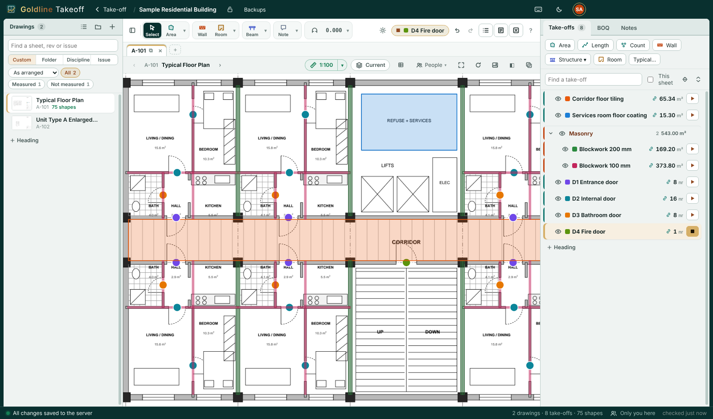
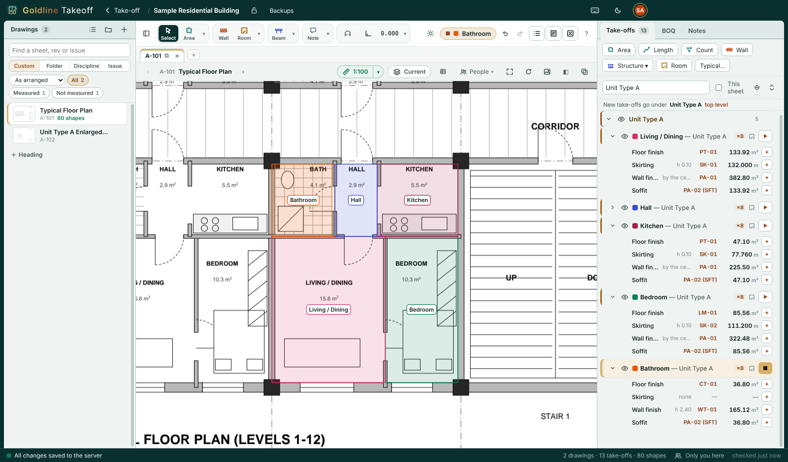
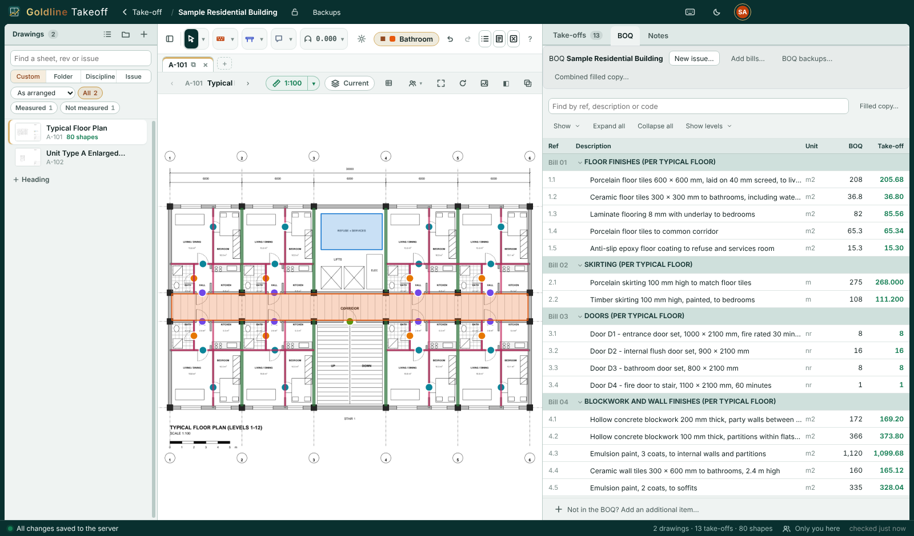
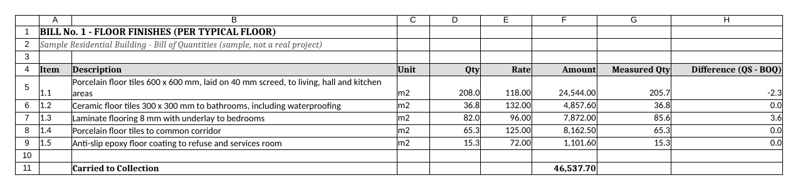
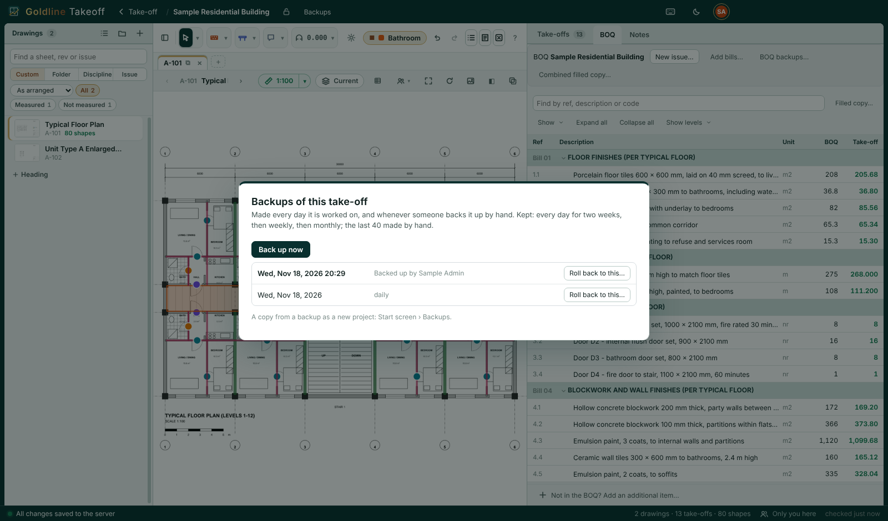

# Goldline Takeoff

Goldline Takeoff measures quantities on PDF drawings and puts them into the client's bill of quantities (BOQ).
It is a take-off tool in the style of PlanSwift, made for teams that share one set of drawings.

Free for anyone to use. Windows 10 / 11, 64-bit.

## Download

Get **Goldline-Takeoff-Setup-&lt;version&gt;.exe** from the [Releases](https://github.com/nabilmunla/goldline-takeoff/releases)
page and run it. It installs for everyone on the PC (asks for admin rights once) or just for you.
Windows may say "Windows protected your PC" (the setup has no paid certificate): press More info, then
Run anyway. Once installed, Goldline Takeoff tells you when a new version is out (see Updates).

## Features

### 1. Area, length, count

The standard measures. Open a PDF drawing, set its scale and measure on it. Every change is saved in the
project as you make it.



### 2. Rooms and finishes

Draw a room once and give it its finishes: floor, skirting, walls and ceiling. The quantities are kept per
room. A typical room is measured once and counted as many times as it occurs.



### 3. Revision overlay

When a new issue of a drawing arrives, it takes the old one's place and the take-offs stay on the sheet.
Shapes measured on the earlier revision are flagged "to check". Compare lays the earlier revision over the
new one, so you see what moved.

### 4. BOQ

Import the client's BOQ (Excel, .xlsx; one file or several). Link your take-offs to its items. The BOQ
quantity and the measured quantity stand side by side.



**Filled copy** puts the quantities back into the client's own file. Pick that file (.xlsx or .xlsm): the app
writes it again as a new file, "&lt;name&gt; - Filled Copy", with two columns added after the last used one:
**Measured Qty** and **Difference (QS - BOQ)**. The client's file is never changed. Items that are not in the
BOQ go on an **Added lines** sheet.



### 5. Live teamwork

Several people can work on one project at the same time, even on the same sheet of the same PDF. Each
person's changes reach the others within seconds.

### 6. Shared drawings

The project links to the PDFs where they already are on the server. The originals are never changed, moved
or copied into the project: everyone works from one set of drawings.

### 7. Heavy drawings

A drawing is read from the server once per PC; after that it opens from that PC's own working copy until
the file on the server changes. It is never loaded whole into memory: only the pages on screen are read, so
a bound set of 350 MB costs a few MB of memory. A sheet made of millions of separate little line pieces
(4 million or more) has its line work simplified on that working copy, drawn the same, so it opens at all.

## Teams and the shared folder

A shared folder (a Windows file share that everyone can reach) holds the accounts, projects and backups.
Each person points the app at it once.

The app also works for one person. Point it at a local folder. The first account is the administrator.

There are two roles:

- **Administrator** (at most 3)
- **Quantity surveyor**

Whoever starts a take-off imports its first BOQ. Later BOQ updates (a new issue of the BOQ, more bills)
are made by an administrator. They reach everyone's copy automatically, live.

Several take-offs can share one BOQ. A **combined filled copy** adds all of them up into the client's BOQ file.

## Backups

Every project is backed up automatically on each day it is worked on, into the shared folder. The app keeps:

- every daily backup for two weeks
- one backup a week for two months
- one backup a month for a year

**Back up now** makes a backup any time. The last 40 hand-made backups are kept.

An administrator, or the owner of the take-off, can roll a take-off back to a backup. The app first makes a
backup of the current state, and **Undo** takes the roll back away again.

Administrators can also open any backup as a new project, beside the current one.



## Updates

About 20 seconds after it starts, and every 4 hours, Goldline Takeoff looks at this repository's latest
release. A new version is offered on a card. Nothing is downloaded until you press **Update**.

Every release is signed by its maker (Ed25519). The app checks each file against its SHA-256 hash. Anything
unsigned or changed is refused. No helper program is ever started for an update.

The app restarts onto the new version. If a new version fails to start, the app goes back to the version
before by itself. Now and then a version needs the setup again: the card says so and opens the release page.

## Privacy

Your projects, drawings and BOQs stay on your PC and in your shared folder. Goldline Takeoff sends nothing
about you or your work: no user count, no problem reports, no crash reports, no analytics. The one thing it
does on the internet is look at this repository on GitHub for a new version, and download it when you press
**Update**. Like any web host, GitHub sees your internet address.

## Building from source

Needs Node 22.

```
npm ci
npm run build
```

`npm test` runs the unit tests. The Windows setup is built with Go (`installer/`). How a release is made and
signed: [tools/README.md](tools/README.md).

## Licence

Goldline Takeoff is free software under the GNU Affero General Public License v3 or later (AGPL-3.0)
([LICENSE](LICENSE)), because it includes MuPDF, which is AGPL. The licences of every part inside it
are in [THIRD-PARTY-NOTICES.txt](THIRD-PARTY-NOTICES.txt).

## About

Made by Nabil Munla, an engineer in the tendering department of a main contractor. Built with
[Claude](https://claude.com) by Anthropic.

It is the sibling of [Rev Radar](https://github.com/nabilmunla/rev-radar) and
[Greenline PDF Editor](https://github.com/nabilmunla/greenline-pdf-editor).

(The pictures are made from generated sample files.)
